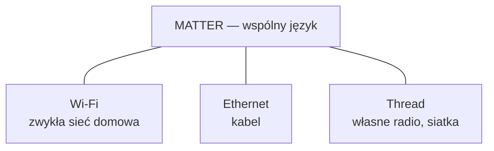
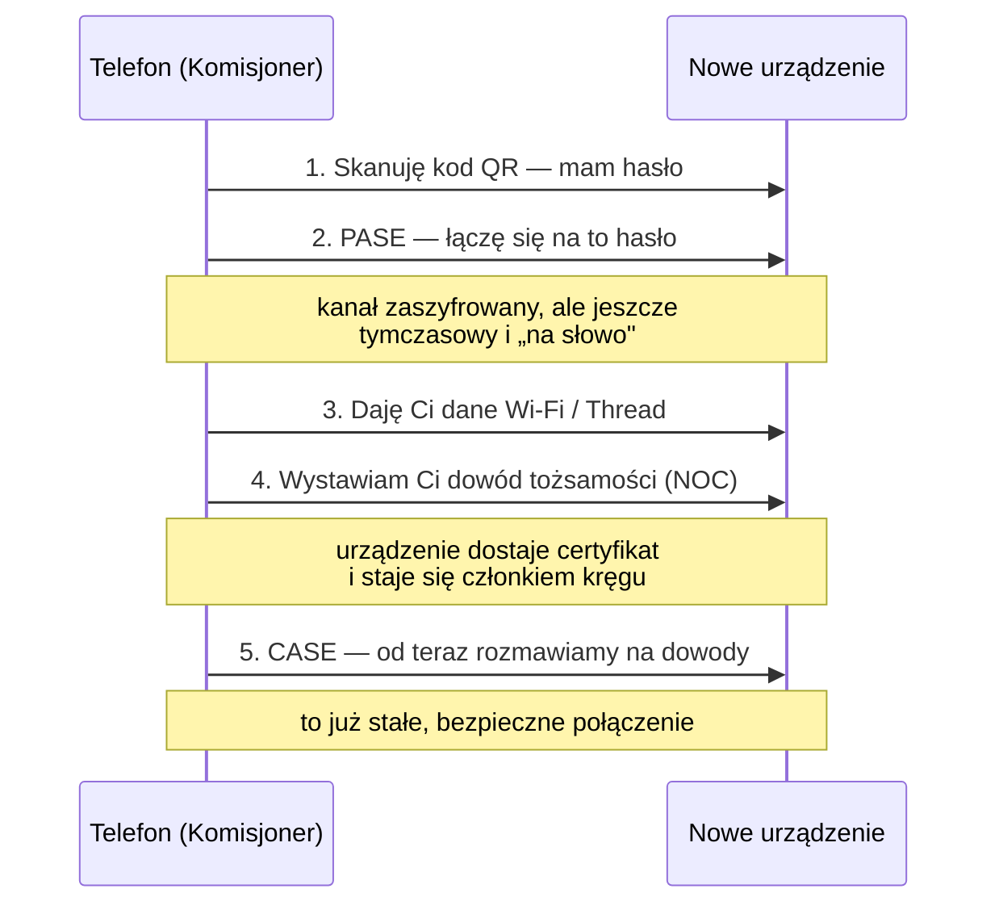

# 01 · Podstawy — jak Matter naprawdę działa

Notatka wyjaśniająca, pisana prostym językiem. Spisane 2026-09-10.
Powiązane: [strategia-protokoly.md](../strategia-protokoly.md) · [wyjasnienie-polnoc-poludnie.md](../wyjasnienie-polnoc-poludnie.md)

---

## 1. Zacznijmy od tego, czym Matter NIE jest

**Matter to nie jest radio.** To jest wspólny język.

Wyobraź sobie, że masz w domu ludzi mówiących po polsku, angielsku i niemiecku.
Matter nie buduje im nowych ust — ustala, że wszyscy używają jednego słownika.

A tym „ustami", czyli drogą, którą głos leci, jest jedno z trzech:



**To rozróżnienie jest źródłem 90% nieporozumień wokół Mattera.** Gdy ktoś mówi
„Matter ma siatkę mesh" — to prawda tylko dla Thread. Po Wi-Fi żadnej siatki nie ma.

---

## 2. Kto jest kim w sieci Matter

Cztery role. Jedno urządzenie może pełnić kilka naraz.

### 🔵 Węzeł (Node) — zwykłe urządzenie

Żarówka, przekaźnik, czujnik. **Każdy ma własny adres IPv6** — to nie jest „podrzędny
sprzęt na sznurku", tylko pełnoprawny uczestnik sieci.

### 🟢 Kontroler / Administrator (Controller / Admin) — mózg

To, co Ty nazywasz centralką: Apple TV, Google Nest Hub, Amazon Echo, Home Assistant,
Twój Odroid. **Wydaje polecenia i zarządza.** Bez przynajmniej jednego kontrolera
sieć Matter nie istnieje.

### 🟡 Komisjoner (Commissioner) — ten, kto wpuszcza nowe urządzenie

Zwykle telefon z aplikacją. To on skanuje kod QR i przeprowadza całą procedurę parowania.
Po zakończeniu jego rola się kończy.

### 🟣 Most (Bridge) — tłumacz ze starszych światów

Urządzenie, które **udaje wiele urządzeń Matter naraz**, a pod spodem gada z nimi
zupełnie innym protokołem — Zigbee, Z-Wave, czymkolwiek.

Przykład: hub z 20 czujnikami Zigbee zgłasza się do Apple Home jako most i mówi
„mam tu 20 urządzeń Matter". Apple widzi 20 urządzeń, a naprawdę jest jedno pudełko,
które tłumaczy.

🎯 **To jest dokładnie ta rola, którą ma pełnić Twój hub.**

---

## 3. 🔴 Czy most wzmacnia sygnał? NIE

To najczęstsze nieporozumienie i warto je raz na zawsze rozstrzygnąć.

**Most tłumaczy, ale niczego nie wzmacnia.** Nie przedłuża zasięgu Wi-Fi ani Mattera.

Co **naprawdę** wzmacnia sygnał w tych sieciach:

| Urządzenie | Czy przekazuje sygnał dalej? |
|---|---|
| Most Matter (bridge) | ❌ **nie** — tylko tłumaczy |
| Urządzenie Matter po **Wi-Fi** | ❌ **nie** — gada tylko z routerem |
| Urządzenie **Thread na stałym zasilaniu** | ✅ **tak** — jest routerem w siatce |
| Urządzenie **Zigbee na stałym zasilaniu** | ✅ **tak** — to samo |
| Urządzenie na baterii (Thread/Zigbee) | ❌ nie — śpi, żeby oszczędzać |

**Zasada, którą warto zapamiętać: sygnał przekazują dalej te urządzenia, które są
wpięte na stałe do prądu i używają radia z siatką (Thread albo Zigbee).**
Żarówka Wi-Fi nie pomoże drugiej żarówce Wi-Fi. Nigdy.

### A czym jest Thread Border Router?

To jeszcze inna rola — **brama między siatką Thread a resztą sieci domowej**.
Thread mówi po IPv6, ale własnym radiem; Border Router przekłada to na Wi-Fi/Ethernet.

Sam też zwykle nie „wzmacnia" — jest bramą. Ale **bez niego siatka Thread nie ma
kontaktu ze światem.** Jeśli chcesz Matter over Thread, musisz mieć przynajmniej jeden.

Dobra wiadomość: **można ich mieć kilka** i wtedy działają redundantnie — gdy jeden
padnie, drugi przejmuje rolę tłumacza.

---

## 4. Jak urządzenia rozmawiają — na pewno nie po HTTP

Twoje przeczucie było słuszne. To **nie jest** HTTP ani REST.

### Transport

- **UDP po IPv6** — do zwykłych poleceń. Szybkie, bez ceregieli. Zapalenie światła
  to jeden mały pakiecik
- **TCP** — tylko do ciężkich rzeczy, np. aktualizacji oprogramowania
- **Multicast IPv6** — gdy chcesz zapalić 20 lamp naraz jednym pakietem (tzw. groupcast)
- **mDNS** — do znajdowania urządzeń w sieci, bez żadnego serwera

⚠️ **Matter jest ściśle oparty na IPv6.** Nie „wspiera też" — wymaga. To dlatego przy
kiepskich routerach operatora Matter potrafi nie działać wcale.

### Model danych — szuflady z funkcjami

Zamiast adresów URL urządzenie ma **klastry** (clusters) — tematyczne szuflady:

```
Żarówka
├── Klaster „On/Off"
│   ├── atrybut: czy świeci (true/false)
│   └── komendy: Włącz, Wyłącz, Przełącz
└── Klaster „Poziom"
    ├── atrybut: jasność (0–254)
    └── komenda: Ustaw poziom
```

**Atrybut** = wartość, którą można odczytać albo zmienić.
**Komenda** = akcja do wykonania.
**Zdarzenie** = coś się stało, urządzenie samo o tym mówi.

### Pięć rodzajów rozmowy

| Rodzaj | Po co |
|---|---|
| **Read** | odczytaj wartość |
| **Write** | zmień wartość |
| **Invoke** | wykonaj komendę |
| **Subscribe** | 🎯 „powiadamiaj mnie, gdy się zmieni" |
| **Report** | urządzenie samo wysyła zmianę |

🟢 **`Subscribe` to najważniejsza rzecz dla Twojego huba.** Nie musisz odpytywać
urządzeń w kółko „i co, i co, zmieniło się?". Raz zamawiasz subskrypcję, a potem
urządzenie samo melduje. Mniej ruchu, mniej prądu, natychmiastowa reakcja.

---

## 5. Parowanie — jak nazywa się i jak działa

Fachowo: **commissioning**. Po polsku: włączenie urządzenia do sieci.



### Rozszyfrujmy trzy skróty

**Kod QR** — na obudowie albo w instrukcji. Zawiera **hasło jednorazowe** i informację,
co to za urządzenie. To jest ten „bilet wstępu".

**PASE** *(Passcode Authenticated Session Establishment)* — pierwsze spotkanie **na hasło**
z kodu QR. Tworzy tymczasowy, zaszyfrowany kanał, żeby przekazać resztę bezpiecznie.

Analogia: pukasz do drzwi i podajesz umówione hasło. Wpuszczają Cię, ale jeszcze nie
jesteś domownikiem.

**NOC** *(Node Operational Certificate)* — **dowód osobisty**, który kontroler wystawia
urządzeniu. Od tej chwili urządzenie należy do kręgu.

**CASE** *(Certificate Authenticated Session Establishment)* — wszystkie kolejne rozmowy
odbywają się **na dowody**, nie na hasło. Obie strony sprawdzają, czy są z tego samego kręgu.

Analogia: hasło było na jeden raz. Teraz macie legitymacje i pokazujecie je przy każdym
spotkaniu.

---

## 6. 🎯 „Gdzie to jest zapisane? Jakieś centrum? Baza danych?"

**To jest najlepsze pytanie z całego zestawu — i odpowiedź brzmi: nie ma żadnego centrum.**

### Fabric — krąg zaufania

Nie ma serwera z listą urządzeń. Zamiast tego istnieje **fabric** — po polsku najbliżej
byłoby „krąg zaufania" albo „rodzina".

Fabric to zbiór urządzeń, które **mają dowody wystawione przez ten sam urząd**.
Każdy fabric ma swój certyfikat główny (Root CA), którym sprawdza się autentyczność.

**Gdzie leżą dane?**

| Co | Gdzie leży |
|---|---|
| Dowód urządzenia (NOC) | **w samym urządzeniu** |
| Lista, komu urządzenie ufa | **w samym urządzeniu** |
| Certyfikat główny kręgu | **w kontrolerze** (Twoim hubie / Apple TV) |
| Lista urządzeń w kręgu | **w kontrolerze** |

🔴 **Nigdzie w chmurze.** Żaden serwer producenta nie musi wiedzieć, że parujesz żarówkę.
Cała komunikacja idzie bezpośrednio między urządzeniami w Twojej sieci.

**To jest właśnie ta cecha, na której opierasz cały produkt.** Matter jest lokalny
nie z uprzejmości producenta, tylko z konstrukcji.

### Multi-admin — jedno urządzenie w kilku kręgach naraz

Urządzenie może należeć **do kilku fabriców jednocześnie** — zwykle do pięciu.

Czyli ta sama żarówka może być w Apple Home, w Google Home i w Twoim hubie **naraz**,
bez konfliktu. Każdy krąg ma własne dowody i własny szyfrowany kanał do niej.

🟢 **Tu jest ogromna różnica wobec kamer Ezviz, o których mówiłeś.** Tam urządzenie
należało do jednego konta w chmurze producenta i koniec. Tu **należy do Ciebie
i możesz je udostępnić komu chcesz**, a reset fabryczny czyści wszystko.

⚠️ Uwaga: **Matter 1.6 dodał „Joint Fabric"** — jeden wspólny krąg współadministrowany
przez kilka ekosystemów, zamiast kilku osobnych. Nowość, warto obserwować.

---

## 7. Co z tego wynika praktycznie

| Pytanie | Odpowiedź |
|---|---|
| Muszę mieć centralkę? | **Tak** — przynajmniej jeden kontroler |
| Muszę mieć Thread Border Router? | Tylko jeśli kupujesz urządzenia **Matter over Thread** |
| Czy most wzmacnia zasięg? | **Nie** |
| Co wzmacnia zasięg? | Urządzenia **Thread/Zigbee na stałym zasilaniu** |
| Czy potrzebuję internetu? | **Nie do działania.** Tylko do dostępu spoza domu i aktualizacji |
| Czy dane idą do chmury? | **Nie z samego Mattera.** Ale firmware producenta może gadać z chmurą osobno — patrz [strategia-protokoly.md](../strategia-protokoly.md) |
| Czy IPv6 jest wymagane? | **Tak, bezwzględnie.** To ryzyko przy routerach operatora |

### Trzy rzeczy do zapamiętania

1. **Matter to język, nie radio.** Siatka mesh jest tylko w Thread
2. **Nie ma żadnego centrum ani chmury** — dowody leżą w urządzeniach, krąg zaufania
   w Twoim hubie
3. **Sygnał wzmacniają wyłącznie urządzenia Thread/Zigbee wpięte na stałe do prądu**

---

## 8. 📚 Oficjalne źródła — gdzie leży prawda

### 🔴 Specyfikacje CSA — pobieranie

**https://csa-iot.org/developer-resource/specifications-download-request/**

To jest **pierwotne źródło** dla wszystkiego, co opisuje ta notatka. Wydawca: Connectivity
Standards Alliance — ta sama organizacja, która stoi za Matterem **i** za Zigbee.

Co stamtąd bierzesz:

| Dokument | Co zawiera |
|---|---|
| **Matter Core Specification** | fundament: warstwy, bezpieczeństwo, PASE/CASE, fabric, transport, model interakcji |
| **Matter Application Cluster Specification** | 🎯 **wszystkie klastry** — każdy atrybut, komenda i zdarzenie |
| **Matter Device Library Specification** | typy urządzeń: co musi mieć „gniazdko", co „licznik energii" |
| **Zigbee Cluster Library (ZCL)** | to samo dla Zigbee — patrz [zigbee-standard-vs-lamanie.md](../zigbee-standard-vs-lamanie.md) |

⚠️ Dostęp przez **formularz** — trzeba podać dane. Bezpłatnie, ale nie jest to zwykły
link do PDF-a.

### Kiedy to realnie otworzysz

Nie na etapie „chcę zrozumieć". Do zrozumienia wystarczy ta notatka.

Sięgasz tam, gdy:

- sprawdzasz, **czy dane urządzenie w ogóle może** wystawić jakąś funkcję przez Matter —
  np. czy `ElectricalMeter` daje współczynnik mocy, czy tylko moc
- piszesz **most Matter** w swoim hubie i musisz wiedzieć, jakie atrybuty wystawić,
  żeby Apple Home rozpoznało urządzenie jako gniazdko
- producent twierdzi, że „Matter tego nie obsługuje", a Ty chcesz to zweryfikować

🎯 **Ten trzeci punkt jest najważniejszy dla Twojego biznesu.** Przy `BASIC-1GSP` mieliśmy
sprzeczne informacje o pomiarze energii przez Matter
([sonoff/07-offline-i-chmura.md](../sonoff/07-offline-i-chmura.md)). Specyfikacja klastrów
rozstrzyga takie spory ostatecznie: albo klaster istnieje i producent go nie zrobił,
albo nie istnieje wcale.

### Pozostałe źródła użyte w tej notatce

- dokumentacja **Silicon Labs** i **Nordic (nRF Connect SDK)** — najlepsze wyjaśnienia
  PASE/CASE i procesu parowania
- **Google Home Developers → Matter Primer** — przystępny opis modelu interakcji
- **Matter Handbook** (`handbook.buildwithmatter.com`)
- **OpenThread** (`openthread.io`) — role węzłów w siatce Thread
