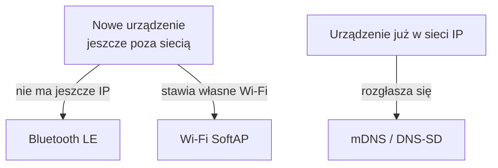
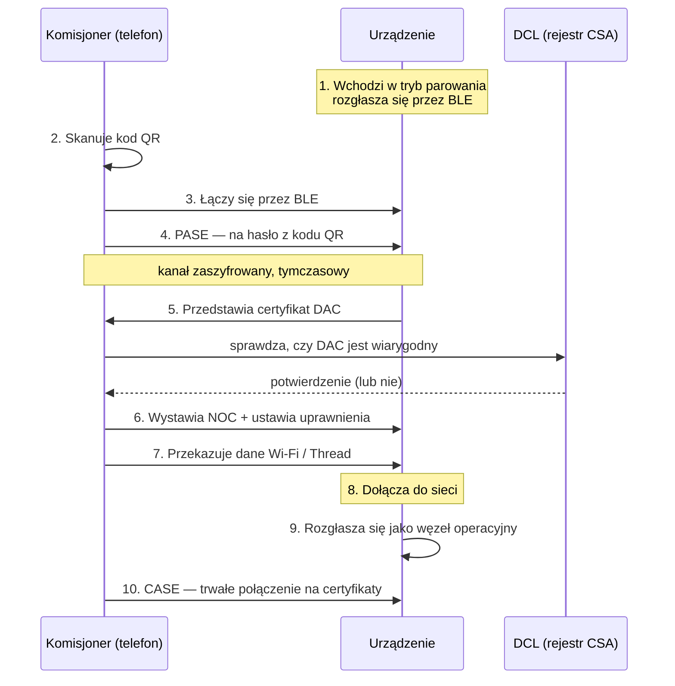
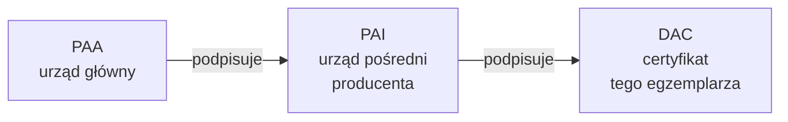

# 03 · Commissioning — parowanie urządzeń od A do Z

Spisane 2026-09-10. Źródła: dokumentacja **Silicon Labs**, **Nordic nRF Connect SDK**,
**Google Home Developers → Matter Primer**, **Matter Handbook** (CSA), przewodnik
**chip-tool** z projektu `connectedhomeip`, plus zgłoszenia z forum Home Assistanta.

Legenda pewności jak w [../KONWENCJA-NOTATEK.md](../KONWENCJA-NOTATEK.md).
Podstawy pojęć: [01-podstawy.md](01-podstawy.md).

> ⚠️ Ten plik przekracza umowny limit 300 linii, bo commissioning to jedno pojęcie
> i dzielenie go zaszkodziłoby. Sekcja 10 (rozwiązywanie problemów) może kiedyś
> odpaść do osobnego pliku.

---

## 1. O co w tym chodzi

**Commissioning** = włączenie nowego urządzenia do Twojej sieci Matter.

Brzmi jak „parowanie Bluetooth", ale jest znacznie poważniejsze. W trakcie tych kilkunastu
sekund dzieje się:

- urządzenie **udowadnia, że jest oryginalne i certyfikowane** (nie podróbka)
- Ty **udowadniasz, że fizycznie je masz** (kod z obudowy)
- urządzenie dostaje **tożsamość** w Twoim kręgu zaufania
- dostaje dane do **Twojej sieci** (Wi-Fi albo Thread)
- ustala się **trwały szyfrowany kanał**

Fachowo: urządzenie, które dołącza, to **commissionee**. To, które je wpuszcza, to
**commissioner**. Zwykle telefon.

---

## 2. Kod QR — co naprawdę jest w środku

Kod na obudowie to nie jest link. To spakowana paczka danych.

**Przykład:** `MT:Y.K9042C00KA0648G00`

| Element | Co znaczy |
|---|---|
| `MT:` | prefiks — „to jest Matter" |
| reszta | dane zakodowane w **base38** |

### Dlaczego akurat base38 (a nie base64)?

Bo kody QR mają tryb **alfanumeryczny**, który obsługuje dokładnie 38 znaków
i pakuje o **~30% gęściej** niż tryb binarny. Efekt: kod jest mniejszy, więc mieści się
na malutkiej naklejce i lepiej się skanuje. Czysta inżynieria pod fizyczny rozmiar etykiety.

### Co jest w środku [DOK]

| Pole | Rozmiar | Do czego |
|---|---|---|
| **Vendor ID (VID)** | 16 bitów | kto to wyprodukował |
| **Product ID (PID)** | 16 bitów | jaki to model |
| **Discriminator** | **12 bitów** | do odróżnienia urządzeń rozgłaszających się jednocześnie |
| **Passcode** | **27 bitów** | 🔴 hasło jednorazowe — sedno całego bezpieczeństwa |
| **Discovery Capabilities** | 8 bitów | maska: czy umie BLE, SoftAP, IP |
| wersja + flagi | kilka | wersja formatu, „custom flow" |

### 🎯 Passcode = dowód, że fizycznie masz urządzenie

To jest **cały fundament bezpieczeństwa parowania**. Nikt z zewnątrz nie sparuje Twojej
żarówki, bo nie widzi naklejki na jej spodzie.

Fachowo nazywa się to **proof of possession** — dowód posiadania. Nie „hasło do konta",
tylko „udowodnij, że trzymasz to w ręku".

⚠️ **[DO SPRAWDZENIA]** Specyfikacja zakazuje trywialnych passcode'ów — takich jak same
zera, same jedynki czy `12345678`. Nie zdołałem potwierdzić pełnej listy w tej sesji;
leży w **Core Specification** (patrz [01-podstawy.md](01-podstawy.md), sekcja 8).

### Discriminator — po co osobne pole

Wyobraź sobie, że rozpakowujesz **pięć identycznych żarówek naraz**. Wszystkie krzyczą
przez BLE „jestem nowa, weźcie mnie". Skąd telefon wie, która to ta z Twojego kodu QR?

**Po discriminatorze.** 12 bitów = 4096 możliwych wartości, przydzielanych losowo.
Telefon filtruje rozgłoszenia i gada tylko z tą właściwą.

---

## 3. Kod ręczny — gdy QR nie wchodzi w grę

**Przykład:** `749701123365521327694`

Nie każde urządzenie da się okleić kodem QR — zamek w drzwiach, głośnik, coś malutkiego.
Wtedy dostajesz **kod cyfrowy do wklepania**. Wersja podstawowa ma **11 cyfr**, dłuższa
(z VID/PID) więcej.

🟢 **Ostatnia cyfra to suma kontrolna (algorytm Verhoeffa)** — wyłapuje literówki
i przestawione cyfry, zanim aplikacja w ogóle spróbuje się łączyć. Dlatego przy pomyłce
dostajesz „nieprawidłowy kod" od razu, a nie po 30 sekundach próbowania.

⚠️ Kod ręczny niesie **mniej informacji** niż QR — nie ma tam pełnych możliwości odkrywania.
Parowanie może przez to trwać dłużej, bo komisjoner musi sprawdzić wszystkie drogi po kolei.

---

## 4. Jak telefon w ogóle znajduje urządzenie

Trzy różne drogi, zależnie od tego, gdzie urządzenie jest.



| Droga | Kiedy używana |
|---|---|
| **Bluetooth LE** | najczęściej. **Wymagana dla urządzeń Thread** — bo Thread jeszcze nie zna Twojej sieci |
| **Wi-Fi SoftAP** | urządzenie stawia własny hotspot, telefon się do niego wpina |
| **mDNS / DNS-SD** | urządzenie już jest w sieci — np. parujesz je do **drugiego** ekosystemu |

### Nazwy usług mDNS — przydatne przy diagnostyce [DOK]

| Usługa | Co ogłasza |
|---|---|
| `_matterc._udp` | **węzeł do sparowania** (jeszcze niczyj) |
| `_matter._tcp` | **węzeł operacyjny** (już w kręgu, gotowy do pracy) |
| `_matterd._udp` | **komisjoner** — dla urządzeń, które same szukają, kto je wpuści |

🎯 **To jest konkretne narzędzie diagnostyczne.** Jeśli parowanie nie wychodzi, sprawdź,
czy w ogóle widzisz rozgłoszenie:

```bash
avahi-browse -rt _matterc._udp
```

Nic nie widać, a urządzenie miga? Problem jest w sieci, nie w urządzeniu.

---

## 5. Przebieg parowania — dziesięć kroków



### Co się dzieje w kroku 4 — PASE

**PASE** = *Passcode Authenticated Session Establishment*. Obie strony znają passcode
(Ty z naklejki, urządzenie z fabryki) i na jego podstawie **wyliczają wspólny klucz**.

🟢 **Kluczowa właściwość: passcode nigdy nie leci przez eter.** Używany jest algorytm
SPAKE2+, w którym obie strony udowadniają znajomość hasła, nie wysyłając go.
Podsłuchujący nie dowie się niczego.

Efekt: tymczasowy, ale już zaszyfrowany kanał, przez który idzie cała reszta.

---

## 6. 🔴 Device Attestation — to tutaj wychodzą podróbki

Krok 5 to najciekawsza część i najczęstsze źródło ostrzeżeń typu
**„niecertyfikowane akcesorium"** w Apple Home czy Google Home.

Urządzenie musi udowodnić, że **naprawdę jest tym, za kogo się podaje** — i że przeszło
certyfikację CSA.

### Łańcuch zaufania



| Skrót | Co to |
|---|---|
| **PAA** — *Product Attestation Authority* | urząd główny, korzeń zaufania |
| **PAI** — *Product Attestation Intermediate* | urząd pośredni, zwykle producenta |
| **DAC** — *Device Attestation Certificate* | 🎯 **unikalny certyfikat KAŻDEGO egzemplarza**, wgrany w fabryce |
| **CD** — *Certification Declaration* | podpisany żeton od CSA: „ten model przeszedł certyfikację" |
| **DCL** — *Distributed Compliance Ledger* | publiczny rejestr: certyfikaty PAA i dane o modelach |

### Jak to sprawdza komisjoner [DOK]

1. Prosi urządzenie o DAC
2. Sprawdza, czy DAC jest podpisany przez PAI
3. Sprawdza, czy PAI jest podpisany przez **zaufany PAA**
4. Zaufane PAA bierze z **DCL**
5. Weryfikuje CD — czy ten VID/PID faktycznie ma certyfikat

**Każde urządzenie ma własny, niepowtarzalny DAC.** Nie da się go skopiować z jednej
sztuki na drugą — klucz prywatny siedzi w zabezpieczonej pamięci układu.

### PAA — kto właściwie jest korzeniem tego zaufania

**CSA nadaje status PAA wybranym organizacjom.** To one stają się urzędami głównymi
w procedurze atestacji. Certyfikat PAA **musi być w DCL**, żeby komisjoner mu zaufał.

Dwa rodzaje, z różnym reżimem audytu: [DOK]

| | **VID-scoped** | **Non-VID-scoped** |
|---|---|---|
| Kto prowadzi | konkretny producent (lub ktoś dla niego) | **firmy trzecie** — np. DigiCert, Kudelski IoT |
| Zakres | ma wbudowany **jeden Vendor ID** | podpisuje PAI **wielu producentom** |
| Audyt | wewnętrzny, wyniki przekazywane do Alliance | **niezależny audyt CAAF** |

**Kiedy własny PAA:** bardzo duże wolumeny + dojrzała obsługa PKI (HSM, ceremonie kluczy)
+ gotowość na cykliczne audyty CSA.
**Kiedy usługa u dostawcy:** praktycznie w każdym innym przypadku — szybsze wejście
na rynek, przewidywalna cena, zero własnej infrastruktury kryptograficznej.

🔴 **Konsekwencja dla własnej marki:** urządzenie Matter wymaga nie tylko certyfikacji CSA,
ale też **stałej relacji ze ścieżką atestacji** — własnym PAA albo kupioną usługą.
Przy **Zigbee i Modbusie nie ma tego w ogóle**. Wzmacnia to wniosek
z [../strategia-modbus-rs485.md](../strategia-modbus-rs485.md): własny sprzęt zaczynamy
od licznika Modbus, nie od urządzenia Matter.

### 🔎 DCL — publiczny rejestr, w którym sprawdzisz każde urządzenie

**DCL** = *Distributed Compliance Ledger*. Po polsku: **rozproszony rejestr zgodności**.

To **publiczna baza prowadzona przez CSA**, która jest jedynym źródłem prawdy o tym,
kto i co przeszło certyfikację Matter.

#### Dlaczego „rozproszony"

Stoi na technologii blockchain (protokół **Tendermint**) i jest **hostowany przez członków
Alliance na serwerach rozsianych po świecie** — CSA celowo rozkłada je geograficznie
możliwie równomiernie. [DOK]

Powód nie jest modą na blockchain, tylko praktyczny: **nikt nie może po cichu podmienić
wpisu o certyfikacji.** Ani producent, ani nawet sama CSA bez śladu.

#### Co jest w środku [DOK]

| Typ wpisu | Zawartość |
|---|---|
| **Vendor** | producenci — kto stoi za danym Vendor ID |
| **Product** | modele, wersje oprogramowania, informacje o aktualizacjach OTA |
| **Compliance status** | **status certyfikacji** z identyfikatorem i datą |
| **PAA Root CA** | certyfikaty główne urzędów atestacji |

#### Kto może pisać, kto czytać

| | Dostęp |
|---|---|
| **Odczyt** | 🟢 **publiczny**, przez węzły obserwatorów |
| **Zapis** | 🔴 tylko zatwierdzone konta: **Vendor**, **Certification Center**, **Trustee** |

Trzy drogi dostępu: **Web UI**, **CLI** (`dcld`) oraz **API** (REST i gRPC).

#### 🎯 I tu jest rzecz przydatna dla Ciebie

**Web UI: https://webui.dcl.csa-iot.org/**

Możesz **sprawdzić dowolne urządzenie przed zakupem** — czy jego Vendor ID i Product ID
faktycznie mają certyfikat, kto je zgłosił i kiedy.

To jest darmowe, autorytatywne narzędzie weryfikacji. Warto dopisać je do testu
akceptacyjnego z [../strategia-doboru-sprzetu.md](../strategia-doboru-sprzetu.md):

> Zanim kupisz partię, sprawdź VID/PID w DCL. Jeśli producent twierdzi „Matter certified",
> a w rejestrze go nie ma — kłamie albo certyfikacja jest w toku.

Skąd wziąć VID i PID? Z kodu QR, poleceniem `payload parse-setup-payload` (sekcja 9).

#### To wyjaśnia ostrzeżenie „niecertyfikowane akcesorium"

Komisjoner pyta DCL: „czy PAA, który podpisał ten łańcuch, jest zaufany?".
Jeśli PAA producenta nie ma w DCL — ostrzeżenie. Stąd bierze się większość takich
komunikatów przy tanim sprzęcie bezmarkowym.

### 💡 Najważniejsza rzecz do zrozumienia: to są DWA różne łańcuchy

Ludzie to nagminnie mylą.

| | **Łańcuch atestacji** | **Łańcuch operacyjny** |
|---|---|---|
| Certyfikaty | PAA → PAI → **DAC** | RCAC → ICAC → **NOC** |
| Kto wystawia | producent + CSA | **Twój kontroler** |
| Kiedy | **w fabryce** | **przy parowaniu** |
| Odpowiada na pytanie | „czy to oryginał?" | „czy to należy do mnie?" |
| Przy resecie fabrycznym | **zostaje** | **kasuje się** |

🎯 **Dlatego reset fabryczny czyści przynależność, ale nie tożsamość.** Urządzenie
zapomina, do kogo należało, ale nadal potrafi udowodnić, że jest oryginalne.

**To jest dokładnie ta właściwość, której brakowało kamerze Ezviz** — tam „przynależność"
siedziała w chmurze producenta i reset jej nie ruszał.

---

## 7. NOC — dowód osobisty w Twoim kręgu

Po pozytywnej atestacji komisjoner wystawia urządzeniu **NOC** (*Node Operational
Certificate*) i ustawia **ACL** — listę uprawnień, kto co może na tym urządzeniu robić.

Od tego momentu urządzenie należy do **fabriku** (kręgu zaufania) — szerzej
w [01-podstawy.md](01-podstawy.md), sekcja 6.

---

## 8. Multi-admin — dokładanie kolejnych ekosystemów

Urządzenie jest już u Ciebie w hubie, a chcesz je mieć też w Apple Home.
**Nie skanujesz ponownie oryginalnego kodu QR** — on jest zużyty.

### Jak to działa naprawdę

**Obecny administrator otwiera okno parowania** i **generuje nowy, tymczasowy kod**.

To się nazywa **Enhanced Commissioning Method (ECM)** i **każde urządzenie oraz każdy
komisjoner musi to obsługiwać** — tak mówi specyfikacja. [DOK]

| Metoda | Jak działa |
|---|---|
| **ECM** — *Enhanced* | obecny administrator generuje **nowy, losowy passcode** i pokazuje świeży kod. **Obowiązkowa** |
| **BCM** — *Basic* | wraca oryginalny passcode z naklejki |

Za otwieranie okna odpowiada klaster **`AdministratorCommissioning`**.

⏱️ **Okno jest czasowe — typowo 15 minut.** Po sparowaniu nowego administratora albo
po upływie czasu zamyka się samo.

🟢 Zwykle **do pięciu fabriców** naraz. Specyfikacja wymaga od certyfikowanych urządzeń
obsługi **co najmniej pięciu**; więcej zależy od pamięci układu. [DOK]

W praktyce w aplikacji nazywa się to „Udostępnij urządzenie", „Add to other service"
albo „Allow commissioning".

---

## 9. Praktyka — chip-tool

`chip-tool` to oficjalne narzędzie z projektu `connectedhomeip`. Świetne do nauki
i do diagnostyki, bo widzisz **każdy krok**, a nie ładny ekran z kręcącym się kółkiem.

### Rozłóż kod na czynniki pierwsze

```bash
chip-tool payload parse-setup-payload MT:6FCJ142C00KA0648G00
```

🎯 **Zrób to jako pierwszą rzecz przy nowym urządzeniu.** Zobaczysz VID, PID,
discriminator i możliwości odkrywania — czyli dowiesz się, czym to naprawdę jest,
zanim cokolwiek podłączysz.

### Parowanie kodem (urządzenie już w sieci)

```bash
chip-tool pairing code 1 MT:8IXS142C00KA0648G00
```

Albo kodem ręcznym:

```bash
chip-tool pairing code 1 34970112332
```

`1` to **node ID**, czyli numer, jaki nadajesz urządzeniu u siebie.

### Parowanie przez BLE do Wi-Fi

```bash
chip-tool pairing ble-wifi 1 MojeWifi MojeHaslo 20202021 3840
```

Kolejność: `<node_id> <ssid> <hasło> <passcode> <discriminator>`

### Parowanie przez BLE do Thread

```bash
chip-tool pairing ble-thread 1 hex:0e080000000000010000000300001335 20202021 3840
```

Zamiast SSID i hasła podajesz **operational dataset** sieci Thread w hex — komplet
parametrów siatki, który wyciągasz z Border Routera.

### Urządzenie już w sieci, znasz passcode

```bash
chip-tool pairing onnetwork 1 20202021
```

### Otwarcie okna dla kolejnego ekosystemu

```bash
chip-tool pairing open-commissioning-window 1 1 300 1000 2365
```

Argumenty: `<node_id> <metoda> <czas_s> <iteracje> <discriminator>`
Metoda `1` = ECM, `0` = BCM. Tu: okno na **300 sekund**.

### Odłączenie urządzenia

```bash
chip-tool pairing unpair 1
```

### Sterowanie i podglądanie

```bash
chip-tool onoff toggle 1 1
```

```bash
chip-tool basicinformation read vendor-name 1 0
```

```bash
chip-tool onoff subscribe on-off 5 10 1 1
```

Ta ostatnia to **subskrypcja** — „melduj zmiany, nie rzadziej niż co 10 s, nie częściej
niż co 5 s". Tak właśnie Twój hub powinien słuchać urządzeń zamiast je odpytywać
(patrz [01-podstawy.md](01-podstawy.md), sekcja 4).

### Kilka kręgów naraz — do testów multi-admin

```bash
chip-tool pairing code 1 MT:... --commissioner-name beta
```

`alpha`, `beta`, `gamma` to osobne tożsamości komisjonera. Pozwala **na jednym komputerze
odegrać dwa różne ekosystemy** i przetestować multi-admin bez kupowania Apple TV.

---

## 10. 🔴 Gdy nie działa — od najczęstszych

### Tabela pierwszej pomocy

| Objaw | Najprawdopodobniejsza przyczyna | Co zrobić |
|---|---|---|
| Parowanie staje w połowie, timeout | **wyłączony IPv6** | włączyć IPv6 w routerze i na hoście |
| „mDNS broadcast failed", „network unreachable" | mDNS nie przechodzi | odblokować UDP **5353** |
| Telefon nie widzi urządzenia, choć jest w tej samej sieci | **izolacja klientów** na AP | wyłączyć „AP isolation" / „client isolation" |
| Działa z telefonu, nie działa z huba | **hub w innym VLAN-ie** | reflektor mDNS albo parowanie z tego samego segmentu |
| Urządzenie Thread nie wchodzi | brak Border Routera albo zły prefiks IPv6 | sprawdzić TBR |
| **„Urządzenie już dodane"** | jest w **innym kręgu** | otworzyć okno w tamtej aplikacji, wziąć **nowy** kod |
| „Niecertyfikowane akcesorium" | atestacja nie przeszła | patrz niżej |
| Kod odrzucany od razu | zła suma kontrolna | literówka — przepisz kod |

### 🔴 Trzy przyczyny odpowiadają za większość problemów

**1 · IPv6.** Matter **wymaga** IPv6. Nie „wspiera też" — wymaga. Wyłączony IPv6 na
routerze operatora albo w Dockerze = parowanie nie ruszy.

**2 · mDNS.** Bez rozgłoszeń urządzenia się nie znajdą. Blokuje to: firewall, granice
VLAN-ów, izolacja klientów, czasem filtrowanie multicastu na przełączniku.

**3 · Izolacja klientów.** Domyślnie włączona na sieciach gościnnych, czasem i na
zwykłych. Urządzenia widzą router, ale nie widzą siebie nawzajem.

### O „niecertyfikowanym akcesorium"

Nie zawsze znaczy „podróbka". Realne powody:

- urządzenie **naprawdę nie ma certyfikatu CSA** (tanie, bezmarkowe)
- ma certyfikat, ale **PAA producenta nie jest jeszcze w DCL**
- błędnie wgrane certyfikaty w fabryce
- sprzęt deweloperski z certyfikatami testowymi

Większość ekosystemów pozwala mimo to sparować, ale ostrzega. **Dla produktu sprzedawanego
klientowi to jest sygnał ostrzegawczy** — takie urządzenie nie trafia na listę klasy A
(patrz [../strategia-doboru-sprzetu.md](../strategia-doboru-sprzetu.md)).

### 🎯 „Urządzenie już dodane" — najczęstsza pułapka przy odsprzedaży

Sparowałeś urządzenie do aplikacji producenta, teraz chcesz do swojego huba i dostajesz
odmowę.

**Rozwiązanie:** wracasz do aplikacji, która je sparowała, szukasz „udostępnij" /
„add to another service" i **generujesz świeży kod**. Oryginalny z naklejki jest zużyty.

Jeśli nie masz dostępu do tamtej aplikacji (sprzęt z drugiej ręki, po kliencie) —
zostaje **reset fabryczny**. Wtedy kasuje się przynależność do wszystkich kręgów.

🟢 **I to jest zasadnicza przewaga Mattera nad kamerami chmurowymi.** Reset fabryczny
naprawdę czyści urządzenie, bo przynależność siedzi **w nim**, a nie na serwerze producenta.
Nie musisz nikogo prosić o odwiązanie.

---

## 11. Ściąga

| Skrót | Rozwinięcie | Po ludzku |
|---|---|---|
| **PASE** | Passcode Authenticated Session Establishment | pierwsze spotkanie na hasło z kodu QR |
| **CASE** | Certificate Authenticated Session Establishment | codzienne rozmowy na certyfikaty |
| **DAC** | Device Attestation Certificate | dowód, że to oryginał — z fabryki |
| **PAI / PAA** | Product Attestation Intermediate / Authority | urzędy wystawiające DAC |
| **CD** | Certification Declaration | żeton od CSA: model certyfikowany |
| **DCL** | Distributed Compliance Ledger | publiczny rejestr certyfikatów |
| **NOC** | Node Operational Certificate | dowód członkostwa w Twoim kręgu |
| **ECM / BCM** | Enhanced / Basic Commissioning Method | nowy kod vs kod z naklejki |
| **Discriminator** | — | numer odróżniający urządzenia w eterze |
| **Passcode** | — | hasło z naklejki, dowód posiadania |

### Trzy zdania na koniec

1. **Kod QR to nie link — to spakowany passcode plus dane identyfikacyjne**, a passcode
   dowodzi, że fizycznie trzymasz urządzenie
2. **Atestacja i tożsamość operacyjna to dwa niezależne łańcuchy certyfikatów** —
   reset fabryczny kasuje drugi, nie rusza pierwszego
3. **Prawie każdy problem z parowaniem to IPv6, mDNS albo izolacja klientów** —
   sprawdzaj w tej kolejności, zanim zaczniesz podejrzewać urządzenie
